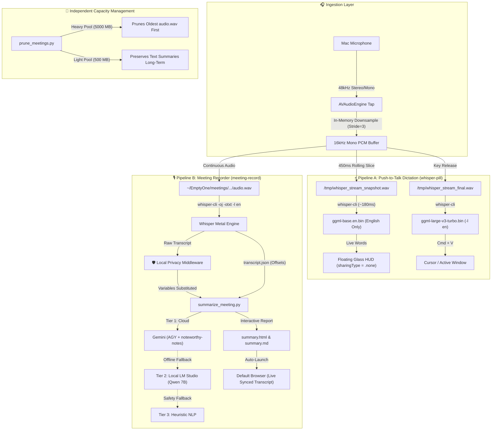

<div align="center">

# 🎙️ Whisper Metal Suite for macOS

**Private, high-performance speech dictation & meeting intelligence powered by Apple Silicon Metal GPU acceleration.**

[-black?logo=apple&style=flat-square)](https://apple.com)
[](https://developer.apple.com/metal/)
[](#-privacy--security)
[](LICENSE)

[Architecture](#-system-architecture) •
[Installation](#-quickstart--installation) •
[Features](#-key-features) •
[Memory & Models](#-memory-footprint--lifecycle) •
[CLI Reference](#-cli-commands)

</div>

---

## 🌟 Highlights

* **⚡ Push-to-Talk Streaming Dictation:** Hold **Right Option (`⌥`)** anywhere on macOS. A 3-line floating translucent HUD displays live words in real time (~180ms latency) and auto-pastes directly at your cursor on release.
* **🎙️ Effortless Meeting Recording:** Double-tap Option (**`⌥ ⌥`**) or click the top menu bar icon (**`🎙️`**) to start or stop meeting recordings without fumbling with complex key combinations.
* **🛡️ Screen-Share Protection (Stealth Mode):** Both floating overlays are built with AppKit `sharingType = .none`. **Zoom, Google Meet, Microsoft Teams, and QuickTime will NEVER show the HUDs to meeting participants.**
* **🔒 Local Privacy Shield (DLP Middleware):** Automatically detects spoken passwords, passcodes, API keys, and credentials, converting them into safe variable placeholders (e.g. `[REDACTED_PASSWORD_1]`) *before* generating notes. **Zero raw credentials leave your machine.**
* **🇬🇧 English-Locked (Zero Russian Hallucinations):** Uses dedicated `base.en` and enforced `-l en` parameters, permanently preventing acoustic noise or silence from misclassifying into Russian Cyrillic.
* **🧠 Multi-Tier AI Synthesis:** Synthesizes executive notes with dynamic domain-specific sections (Product Vision, Architecture, Risks, Decisions). Falls back automatically to offline local models (LM Studio / Qwen 2.5 Coder) if cloud Gemini times out or is offline.
* **🎧 Audio-Synced Interactive Web Dashboards:** Generates responsive `summary.html` dashboards with an audio player, auto-scrolling moving transcript, sentence-level click-to-seek, and 1-click Markdown export.
* **💾 Dual-Pool Independent Retention:** Manages heavy audio files (5GB limit, deleted first) separately from lightweight text notes (500MB limit, preserved long-term).

---

## 🗺️ System Architecture



---

## 🚀 Quickstart & Installation

### Prerequisites
* Apple Silicon Mac (M1, M2, M3, M4, or M5) running macOS Ventura, Sonoma, or Sequoia.
* [Homebrew](https://brew.sh) installed.

### 1-Click Install
Clone this repository and run the setup script:

```bash
git clone https://github.com/your-username/whisper-metal-suite.git
cd whisper-metal-suite
chmod +x install.sh
./install.sh
```

The installer will:
1. Install `whisper.cpp` and `ffmpeg` via Homebrew.
2. Download the optimized Metal models (`ggml-base.en.bin` and `ggml-large-v3-turbo.bin`) into `~/.whisper-models/`.
3. Compile the native Swift daemons with Apple Metal GPU optimization.
4. Symlink binaries to `~/.local/bin/` and start the background services.

---

## 🎮 How to Use

### 1. Push-to-Talk Speech Dictation
* **Hold Right Option (`⌥`)**: Speak naturally. The floating pill HUD shows live rolling words.
* **Release Right Option**: The final high-accuracy text is transcribed and automatically pasted (`Cmd+V`) into your active application.

### 2. Meeting Recording & Summarization
* **Start / Stop Recording**: Double-tap Option (**`⌥ ⌥`**) or click the **`🎙️`** status item in your top menu bar.
* **Stealth Mode (Screen-Share Safe)**:
  ```bash
  meeting-record start --stealth   # Launches with HUD completely hidden
  meeting-record stealth           # Toggles stealth mode on the active daemon
  ```
* **View Meeting Notes**:
  Upon stopping the recording, `summary.html` automatically opens in your default browser. Click any sentence in the transcript to jump playback to that exact second!

---

## 🧠 Memory Footprint & Lifecycle

| Component | Model / Daemon | Role | RAM Footprint | Lifecycle Mode |
| :--- | :--- | :--- | :--- | :--- |
| **Dictation Slices** | `ggml-base.en.bin` | Instant live streaming preview | **0 MB idle** (~148 MB during 180ms slice) | **On-demand Subprocess** (exits immediately) |
| **Final Pass & Meetings** | `ggml-large-v3-turbo.bin` | High-accuracy transcription | **0 MB idle** (~1.6 GB during 1.2s pass) | **On-demand Subprocess** (exits immediately) |
| **Local LLM Fallback** | `qwen2.5-coder-7b` | Offline structured note synthesis | **~4.35 GB resident** | **Persistent Daemon** (LM Studio port 1234) |
| **Dictation Daemon** | Native Swift (`whisper-pill`) | Global hotkey listener | **~42 MB** | Persistent AppKit event loop |
| **Meeting Daemon** | Native Swift (`meeting-recorder`)| Global hotkey & menu bar | **~22 MB** | Persistent AppKit event loop |

> **Key Takeaway:** Whisper models are **never** held resident in RAM when idle. They spawn as isolated subprocesses, transcribe on the Metal GPU, and exit immediately, returning 100% of memory to macOS.

---

## 🔒 Privacy & DLP Protection

### Does Gemini Ever Hear Your Audio?
**No. 100% of audio recording and Whisper speech recognition runs offline on your Apple Silicon Metal GPU. Zero audio leaves your Mac.**

### Spoken Credential Sanitization
If passwords or API keys are spoken during a meeting:
1. The **Local Privacy Middleware** scans the transcript using local regex patterns and the local LM Studio model.
2. Real credentials are replaced with generic variables:
   * `"staging database password is AlphaSecret!2026"` $\longrightarrow$ `"staging database password is [REDACTED_PASSWORD_1]"`
   * `"our Stripe key is sk-proj-999..."` $\longrightarrow$ `"our Stripe key is [REDACTED_API_KEY_1]"`
3. Cloud Gemini **only** receives the sanitized transcript with variable placeholders.
4. A local `sanitization_report.json` is generated for compliance audit.

For full technical details, see [`docs/PRIVACY_AND_DLP.md`](docs/PRIVACY_AND_DLP.md).

---

## 💻 CLI Commands

### Meeting Recorder (`meeting-record`)
```bash
meeting-record toggle             # Start or stop recording
meeting-record start --stealth    # Start in screen-share safe stealth mode
meeting-record stealth            # Toggle stealth mode on/off
meeting-record status             # Check if daemon is active
meeting-record open               # Open meetings directory in Finder
meeting-record retention 5000 500 # Set audio (5000MB) and text (500MB) capacity
meeting-record prune              # Run manual retention cleanup
```

### Dictation Daemon (`whisper-daemon`)
```bash
whisper-daemon status             # Check daemon status
whisper-daemon trigger            # Toggle dictation via CLI
whisper-daemon restart            # Recompile / reload daemon
whisper-daemon logs               # View real-time output logs
```

---

## 📂 Repository Structure

```text
whisper-metal-suite/
├── install.sh                  # 1-Click idempotent installer
├── LICENSE                     # MIT License
├── README.md                   # Project documentation
├── src/
│   ├── dictation/
│   │   ├── whisper_pill.swift  # Native Swift live dictation HUD
│   │   └── whisper-daemon      # Dictation CLI manager
│   ├── meetings/
│   │   ├── meeting_recorder.swift # Native Swift meeting recording daemon
│   │   ├── meeting-record      # Meeting CLI manager
│   │   ├── summarize_meeting.py# Multi-tier AI synthesizer & DLP middleware
│   │   └── prune_meetings.py   # Dual-pool capacity retention engine
│   └── common/
│       └── whisper_metal.py    # Python Whisper Metal CLI helper
├── docs/
│   ├── ARCHITECTURE_AND_MODELS.md # In-depth memory & model specifications
│   └── PRIVACY_AND_DLP.md      # Local privacy shield documentation
└── web/
    └── index.html              # Interactive browser architecture dashboard
```

---

## 📄 License
Released under the [MIT License](LICENSE).
