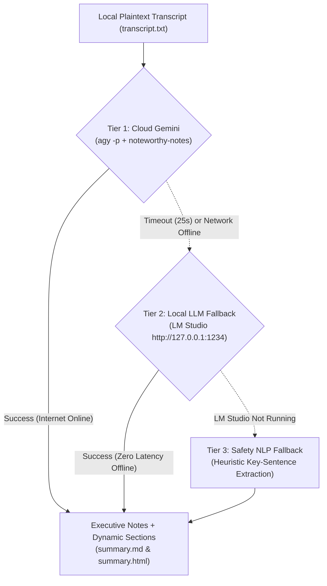
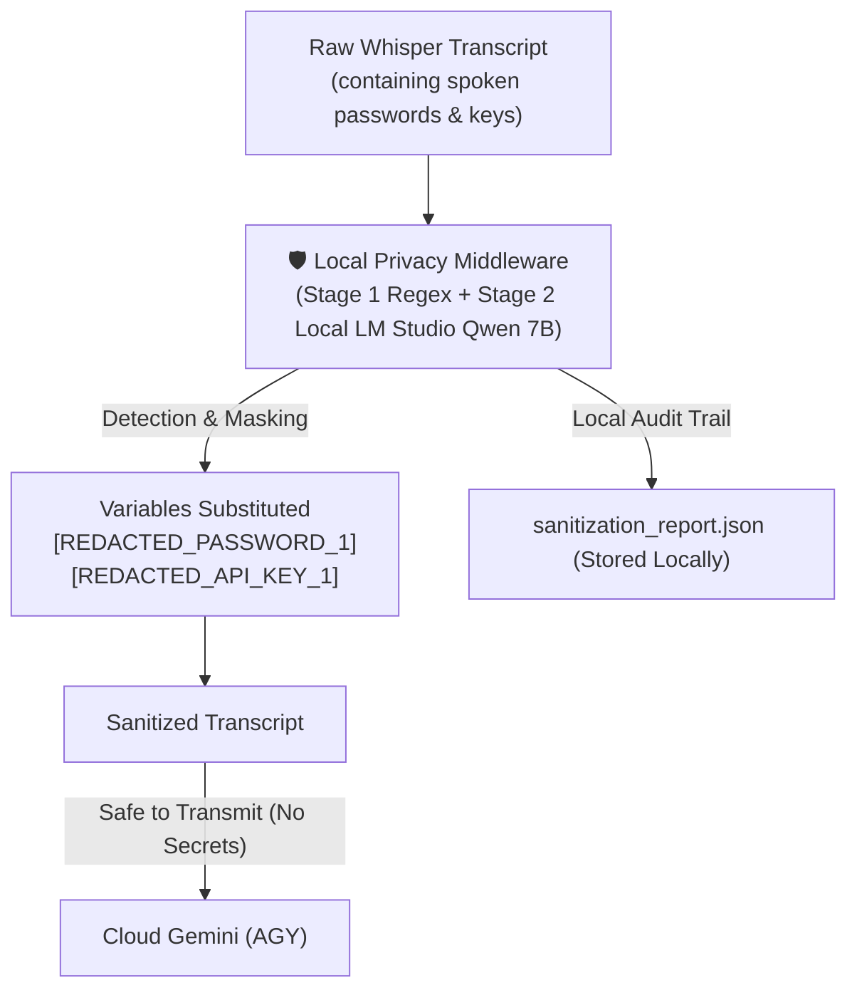

# 📖 System Architecture, Model Lifecycles & Memory Impact

> **Living Documentation (DOC)**: Maintained for the Apple Silicon local Whisper dictation & meeting intelligence stack in `/Users/test/EmptyOne/`.

---

## 1. Quick Reference: Model Inventory

| Model Name | Type | Engine / Backend | Location / Port | Disk Size | Active Memory (RAM/VRAM) | Lifecycle |
| :--- | :--- | :--- | :--- | :--- | :--- | :--- |
| **`ggml-base.en.bin`** | ASR (Speech-to-Text) | `whisper-cli` (Metal GPU) | `~/.whisper-models/` | 148 MB | **0 MB idle** (~148 MB for ~180ms during slice) | **On-Demand Subprocess** (unloaded after each 450ms slice) |
| **`ggml-large-v3-turbo.bin`** | ASR (Speech-to-Text) | `whisper-cli` (Metal GPU) | `~/.whisper-models/` | 1.62 GB | **0 MB idle** (~1.6 GB for ~1.5s during final pass) | **On-Demand Subprocess** (unloaded immediately after transcription) |
| **`qwen2.5-coder-7b-instruct`** | Local LLM (Synthesis) | LM Studio (`llama-server`) | `http://127.0.0.1:1234` | ~4.7 GB (Q4_K_M) | **~4.35 GB Resident** | **Persistent Daemon** (loaded in Unified Memory while LM Studio is open) |
| **`Gemini` (via AGY)** | Cloud AI (Synthesis) | Antigravity CLI (`agy -p`) | Google Cloud API | Cloud-hosted | **0 MB Local RAM** | **Network Request** (runs during meeting summarization only) |

---

## 2. Memory Impact & Model Lifecycle Deep Dive

### Q: Are Whisper models loaded into memory all the time, or on-demand?
**Answer: Whisper models are loaded strictly ON-DEMAND and are NOT resident in memory when idle.**

#### How Whisper Lifecycle Works:
1. **Background Daemons are Lightweight (~20–42 MB):**
   - The native Swift daemons ([`whisper-pill`](file:///Users/test/.local/bin/whisper-pill) and [`meeting-recorder`](file:///Users/test/.local/bin/meeting-recorder)) run in the background listening for global key events (`NSEvent`).
   - Their memory footprints are minimal:
     - `whisper-pill`: **~42 MB RSS**
     - `meeting-recorder`: **~22 MB RSS**
   - They do **not** keep Whisper model weights in memory.

2. **On-Demand Subprocess Execution (`whisper-cli`):**
   - When you hold `Right Option` to speak, or when a meeting recording ends, the daemon spawns `/opt/homebrew/bin/whisper-cli` as an isolated subprocess.
   - `whisper-cli` memory-maps the weights (`mmap`) directly into Apple Silicon Unified Memory and initializes the Metal GPU shaders.
   - **Execution Duration:**
     - **Streaming Live Slice:** `ggml-base.en.bin` executes in **~180 milliseconds**, prints the partial transcript, and the process **exits**.
     - **Final Transcription:** `ggml-large-v3-turbo.bin` transcribes the finished audio in **~1.2 seconds**, writes `transcript.txt` and `transcript.json`, and **exits**.
   - **Instant Memory Reclamation:** As soon as `whisper-cli` exits, the macOS kernel immediately frees all allocated GPU buffers and unified memory pages. **Idle RAM usage is 0 MB.**

---

### Q: What about the Local LLM (LM Studio)?
**Answer: LM Studio is persistent in unified memory (~4.35 GB) to provide zero-latency local fallback.**

- The process `llama-server` (PID 83785) is managed by LM Studio.
- It loads `qwen2.5-coder-7b-instruct-q4_k_m.gguf` completely into Apple Silicon unified memory with `mlock` and Metal offloading.
- This ensures that if Gemini is unavailable, offline, or times out, the local synthesis query responds in **under 4 seconds** with zero cold-start delay.
- *Note:* If you ever want to free this 4.35 GB of RAM when not doing meeting summarizations, simply click "Eject Model" or quit LM Studio.

---

## 3. When is Gemini Used vs. Local LLMs?

### Phase 1: Audio Recording & Listening (100% Local & Private)
* **Is Gemini used during recording? NO.**
* Neither Gemini nor any external cloud service is ever connected during audio recording or dictation.
* Audio capture is handled locally by macOS `AVAudioEngine` in RAM.
* Speech-to-text is executed 100% on your Apple M5 Metal GPU via `whisper-cli`.
* **Zero bytes of audio ever leave your Mac.**

---

### Phase 2: Meeting Summarization & Note Synthesis (Multi-Tier)
Once the local Whisper transcription is saved as text (`transcript.txt`), the Python engine [`summarize_meeting.py`](file:///Users/test/EmptyOne/summarize_meeting.py) runs the text-only synthesis through a multi-tier fallback architecture:

1. **Tier 1 (Gemini Cloud AI via `agy -p`):**
   - Receives the *text transcript* (no audio) and applies the `noteworthy-notes` prompt template to extract high-level themes, decisions, action items, and dynamic domain sections.
   - It is bounded by a **25-second strict timeout**.
2. **Tier 2 (Local LLM via LM Studio):**
   - If Gemini times out, throws a network error, or if you are offline on an airplane, the script instantly falls back to `http://127.0.0.1:1234/v1/chat/completions`.
   - Your local `qwen2.5-coder-7b` model synthesizes the structured JSON notes locally in ~3.8 seconds.
3. **Tier 3 (Safety Fallback):**
   - If both Gemini and LM Studio are offline, a rule-based NLP parser extracts key sentences so `summary.html` is always created without crashing.

---

## 4. Local Privacy Middleware & Sensitive Data Redactor (Zero Cloud Leakage)

### How Spoken Passwords & Secrets Are Guarded:
When speaking in meetings, confidential data (passwords, API keys, tokens, connection strings) may naturally be spoken aloud. 

To prevent **any** sensitive information from being transmitted to Gemini, a **Local Privacy Middleware** runs on-device immediately after Whisper finishes transcribing:

1. **Two-Stage Detection:**
   - **Stage 1 (Local Regex Engine, ~1ms):** Instantly captures spoken password phrases (`password is ...`, `passcode is ...`, `secret key is ...`), API keys (`sk-...`, `ghp-...`, `AIza...`, `AKIA...`), and bearer tokens.
   - **Stage 2 (Local LLM DLP Auditor, ~1.5s):** If LM Studio is running, queries `qwen2.5-coder-7b` locally to detect tricky conversational secrets or ambiguous credentials.
2. **Variable Substitution:**
   - Replaces exact secret strings with generic variable placeholders: `[REDACTED_PASSWORD_1]`, `[REDACTED_API_KEY_1]`.
   - **Gemini ONLY receives the sanitized transcript.** Real credentials never touch Google servers.
3. **Audit & UI Transparency:**
   - Generates a local `sanitization_report.json` with masked previews (`Al***2`).
   - Renders a prominent **🛡️ Local Privacy Shield** badge in both `summary.html` and `summary.md`.

---

## 5. Language Locking: Why Russian Happened & How It's Fixed

### The Problem:
- Multilingual models like `parakeet-tdt-0.6b` and `whisper-large-v3-turbo` possess joint multilingual vocabularies.
- When audio begins with silence, keyboard clicks, breathing, or quiet speech, unconstrained language detection (`language: auto`) frequently misclassifies acoustic noise as Russian Cyrillic phonetics (e.g. *"I want some digestion like tool"* became *"Мейк а Финишуп док."*).

### The Permanent Fix:
1. **Live Dictation Streaming:** Uses [`ggml-base.en.bin`](file:///Users/test/.whisper-models/ggml-base.en.bin). Because `.en` models contain exclusively English tokens in their tokenizer, it is mathematically incapable of generating Cyrillic or Russian characters.
2. **Final Passes & Meeting Recording:** Calls `whisper-cli` with explicit `-l en`. This forces the decoder logits to lock to the English language token, permanently suppressing Russian auto-detection.

---

## 5. Storage & Capacity Management

Meeting artifacts are stored in `~/EmptyOne/meetings/Meeting_YYYY-MM-DD_HH-mm-ss/`:
- `audio.wav` (~10–30 MB per meeting): Raw 16kHz audio.
- `transcript.json` (~50 KB): Millisecond word and segment timestamps for synced audio playback.
- `transcript.txt` (~5 KB): Plain transcript text.
- `summary.md` (~3 KB): Clean Markdown notes for easy copying.
- `summary.html` (~25 KB): Interactive dashboard with moving synced transcript.

The independent dual-pool pruner ([`prune_meetings.py`](file:///Users/test/EmptyOne/prune_meetings.py)) enforces separate capacity limits configured in `retention.json`:
- **Audio Pool (5000 MB):** Oldest `audio.wav` files are deleted first when capacity is reached.
- **Text Pool (500 MB):** HTML dashboards, Markdown summaries, and transcripts are preserved indefinitely for long-term historical search.
