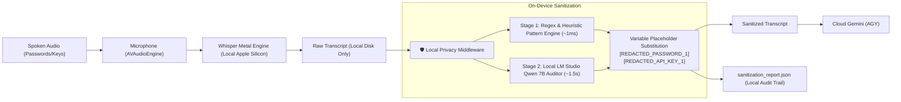

# 🛡️ Local Privacy Shield & Sensitive Data DLP Middleware

The **Whisper Metal Suite** includes an automated, on-device Data Loss Prevention (DLP) middleware designed to eliminate accidental credential leakage during cloud meeting note synthesis.

---

## 1. Problem Statement
When conducting engineering meetings or architectural discussions, sensitive credentials are often spoken aloud:
- Staging database passwords
- API keys (OpenAI, Stripe, Google, AWS, GitHub)
- Session tokens, private keys, and connection strings

If raw audio or unmodified transcripts were forwarded directly to cloud LLMs (such as Google Gemini), these credentials would be transmitted across the network, violating security policies.

---

## 2. Zero-Leakage Architecture

Our solution ensures **0% of audio and 0% of raw credentials ever leave the host machine**:

---

## 3. Two-Stage Detection Engine

### Stage 1: Local Regex & Pattern Engine (~1ms)
High-precision regular expressions inspect the text for standard credential structures:
- **Spoken Passwords:** Identifies phrases like `"the password is [X]"`, `"staging passcode is [X]"`, `"pin: [X]"`, `"password: [X]"`.
- **API Keys:**
  - OpenAI / Anthropic: `\b(sk-[A-Za-z0-9_-]{20,})\b`
  - GitHub Personal Access Tokens: `\b(ghp_[A-Za-z0-9]{30,}|gho_[A-Za-z0-9]{30,})\b`
  - Google Cloud / Firebase API Keys: `\b(AIza[0-9A-Za-z-_]{35})\b`
  - AWS Access Keys: `\b(AKIA[0-9A-Z]{16})\b`
  - Bearer Tokens: `\bBearer\s+([A-Za-z0-9._-]{20,})\b`
  - Hex Secrets & Hashes: 32–64 character high-entropy alphanumeric strings.

### Stage 2: Contextual Local Model Auditor (~1.5s)
If [LM Studio](https://lmstudio.ai/) is running on port 1234, the script queries `qwen2.5-coder-7b` locally as a contextual security auditor. It detects conversational, subtle, or unstructured secrets (such as informal passphrases) that pure regex might miss.

---

## 4. Variable Substitution
All identified secrets are sorted by length descending and replaced with clean variable placeholders:
- `AlphaSuperSecret!992` $\longrightarrow$ `[REDACTED_PASSWORD_1]`
- `sk-proj-999988887777...` $\longrightarrow$ `[REDACTED_API_KEY_1]`
- `AKIA1234567890ABCDEF` $\longrightarrow$ `[REDACTED_API_KEY_2]`

### Cloud LLM Perspective:
When Gemini processes the prompt:
- It understands that the team was discussing "staging database credentials" and "AWS deployment access".
- It refers exclusively to `[REDACTED_PASSWORD_1]` and `[REDACTED_API_KEY_1]`.
- The real secret strings are **never** present in the prompt, token stream, or cloud logs.

---

## 5. Local Audit Trail & Web Dashboard

For compliance and transparency, each meeting generates:
1. **`sanitization_report.json`**: An on-disk audit trail showing the type of credential redacted, masked preview (`Al***2`), and corresponding variable name.
2. **Interactive UI Badge (`summary.html`)**: An emerald shield card detailing the number of protected items.
